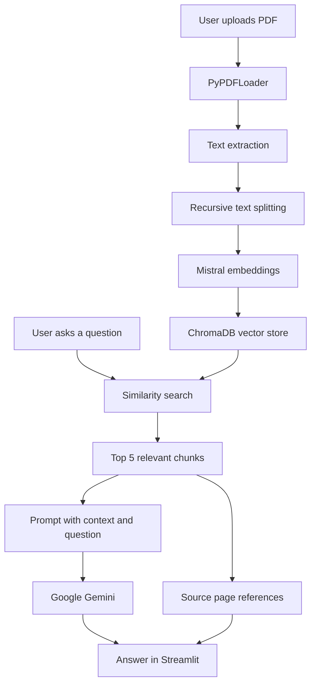

# PDF RAG Chatbot

A Streamlit application that lets users upload a PDF document and ask questions about its contents. It uses a Retrieval-Augmented Generation (RAG) pipeline: document text is split into chunks, embedded with Mistral, stored in a session-specific Chroma vector database, and retrieved to provide context to Google's Gemini model.

## Features

- **PDF upload and processing** — upload a PDF directly in the Streamlit sidebar.
- **Document chunking** — extract PDF pages and split their text into chunks of 1,000 characters with 200 characters of overlap.
- **Vector embeddings** — generate embeddings using Mistral's `mistral-embed` model.
- **Vector storage and retrieval** — store document chunks in ChromaDB and retrieve the five most relevant chunks for a question using similarity search.
- **Context-based answer generation** — send the retrieved context and question to Google's Gemini model with instructions to avoid unsupported answers.
- **Source page references** — show the page numbers associated with retrieved passages.
- **Session-based chat state** — keep the active document and conversation history in Streamlit session state, with an option to clear the document.

## How it works

1. **Upload:** The user uploads a PDF through the Streamlit interface.
2. **Load:** The PDF is temporarily written to disk and read with LangChain's `PyPDFLoader`.
3. **Split:** `RecursiveCharacterTextSplitter` divides the extracted text into 1,000-character chunks with a 200-character overlap.
4. **Embed and store:** `MistralAIEmbeddings` creates vector embeddings, which are stored in a ChromaDB collection named `pdf_collection` under `chroma_db/<session_id>/`.
5. **Retrieve:** For each question, ChromaDB similarity search retrieves the top five relevant chunks.
6. **Generate:** The retrieved text and question are inserted into a prompt and sent to Gemini. The application displays the generated answer and the source page numbers.



## Tech stack

| Component | Technology |
|---|---|
| User interface | Streamlit |
| RAG orchestration and prompts | LangChain |
| PDF loading | PyPDFLoader (`langchain-community`) |
| Text splitting | RecursiveCharacterTextSplitter |
| Embeddings | Mistral `mistral-embed` |
| Vector database | ChromaDB |
| Answer generation | Google Gemini through LangChain's `init_chat_model` |
| PDF parsing | pypdf |

## Project structure

```text
rag-document-chatbot/
├── app.py                 # Streamlit UI, upload flow, chat history and source display
├── create_database.py     # PDF loading, chunking, embedding and ChromaDB creation
├── main.py                # Retriever, prompt construction and Gemini answer generation
├── requirements.txt       # Python dependencies
├── .env.example           # Names of required environment variables (placeholders only)
├── .gitignore             # Excludes secrets, generated databases and cache files
└── README.md              # Project documentation
```

At runtime, the application creates `chroma_db/<session_id>/` for the uploaded PDF. The generated vector database is not included in the repository.

## Setup and run locally

### 1. Clone the repository

```bash
git clone https://github.com/Sammihan/rag-document-chatbot.git
cd rag-document-chatbot
```

### 2. Create and activate a virtual environment

**Windows (Command Prompt):**

```cmd
python -m venv venv
venv\Scripts\activate
```

**macOS / Linux:**

```bash
python3 -m venv venv
source venv/bin/activate
```

### 3. Install dependencies

```bash
pip install -r requirements.txt
```

### 4. Configure API keys

Create a file named `.env` in the project root (you can copy `.env.example` and rename it to `.env`) and add your own keys:

```env
GOOGLE_API_KEY=your_google_api_key
MISTRAL_API_KEY=your_mistral_api_key
```

You need:

- A Google API key with access to the Gemini model configured in `main.py`.
- A Mistral API key for the `mistral-embed` embedding model.

**Keep your real `.env` file private.** It is excluded from Git by `.gitignore`. Never commit or share API keys.

### 5. Run the application

```bash
streamlit run app.py
```

Streamlit will print a local URL (usually `http://localhost:8501`) to open in your browser.

## Deploying to Streamlit Community Cloud

1. Push this repository to GitHub.
2. In [Streamlit Community Cloud](https://share.streamlit.io/), create a new app and select this repository, branch `main`, and file `app.py`.
3. In the app's **Settings → Secrets**, add your API keys in TOML format:

   ```toml
   GOOGLE_API_KEY = "your_google_api_key"
   MISTRAL_API_KEY = "your_mistral_api_key"
   ```

4. Deploy the app.

The application reads the Streamlit secrets and places the values into environment variables before importing the modules that initialize the embedding and chat models.

> **Runtime storage note:** ChromaDB files are created in the app's local `chroma_db/` directory when a PDF is processed. This is runtime storage, not persistent cloud storage. A restart or a new app instance may remove that data, so users may need to upload and process their PDF again.

## Current configuration

The following settings are defined in the source code:

| Setting | Current value |
|---|---|
| Embedding model | `mistral-embed` |
| Chat model | `gemini-3.5-flash-lite` |
| Chunk size | 1,000 characters |
| Chunk overlap | 200 characters |
| Retrieved chunks | 5 |
| Chroma collection | `pdf_collection` |
| Retriever search type | Similarity |

## Current scope and limitations

- The application currently accepts PDF uploads.
- Answers depend on the text extracted from the uploaded PDF and the chunks returned by similarity search.
- The prompt instructs Gemini to say when the answer cannot be found in the supplied context; this instruction does not guarantee that every answer will be perfectly grounded.
- Chat history and the active document path are held in Streamlit session state. The project does not currently include durable user accounts or persistent conversation storage.
- The vector database is generated at runtime and is not committed to Git.

## License

No license has been added to this repository yet. Until a license is selected, assume that normal copyright applies and reuse is not automatically granted.
